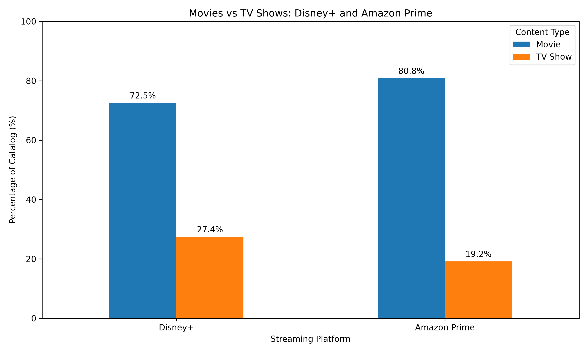
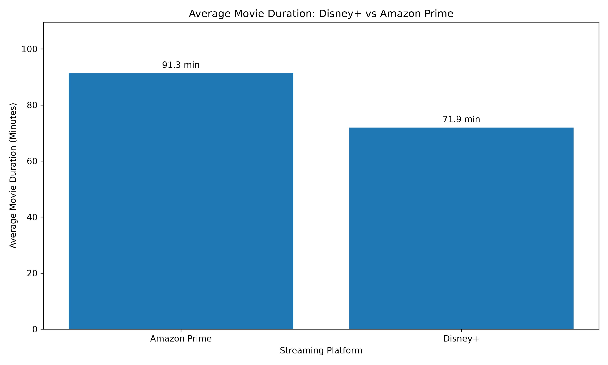
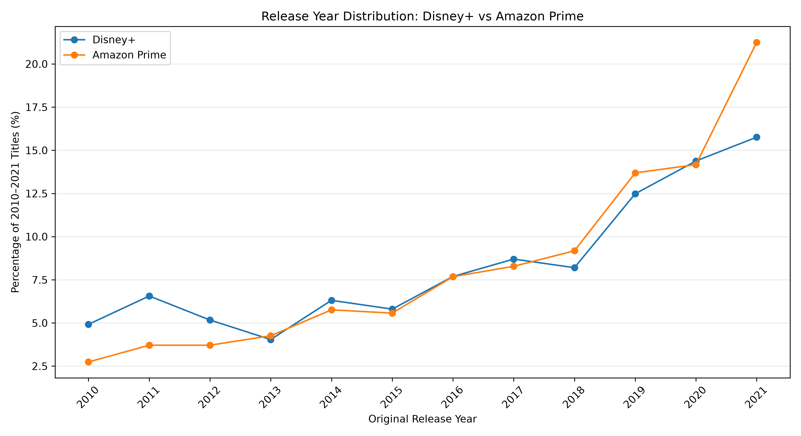
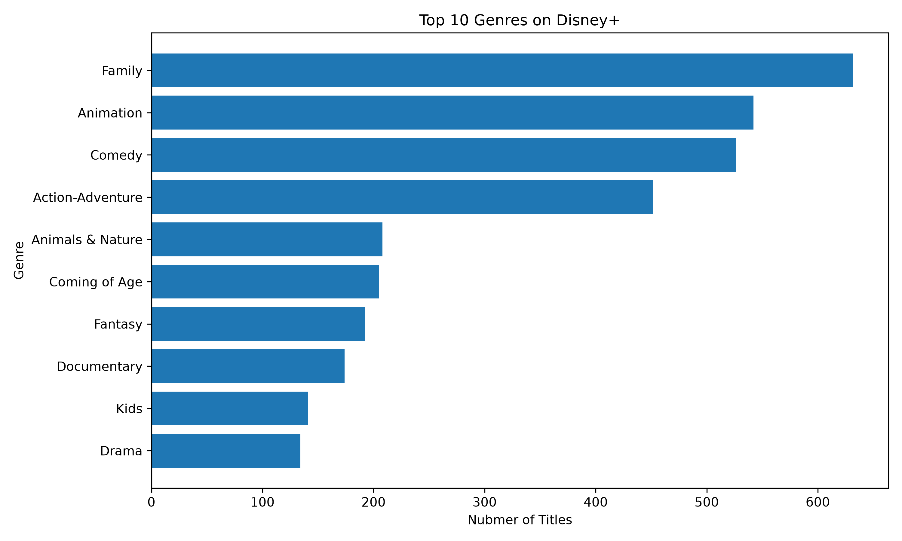
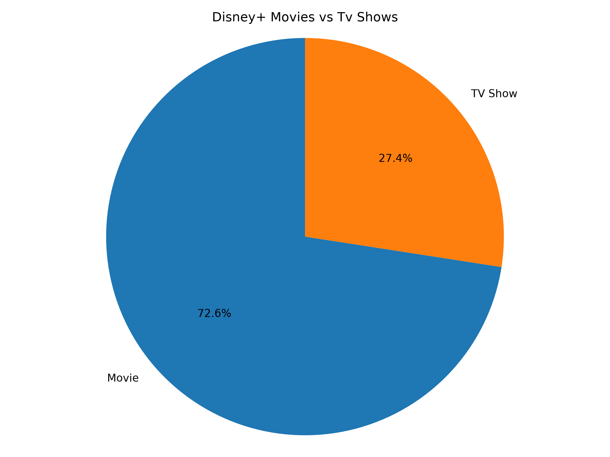
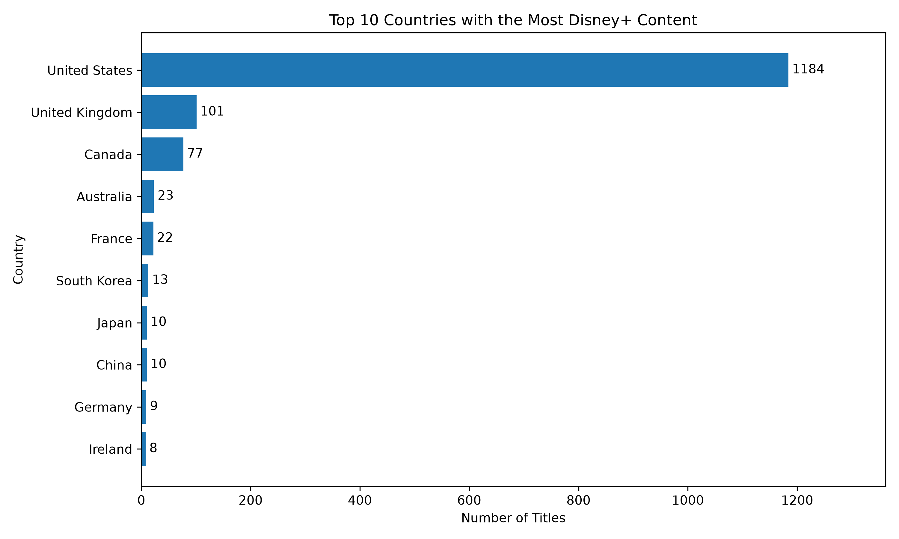
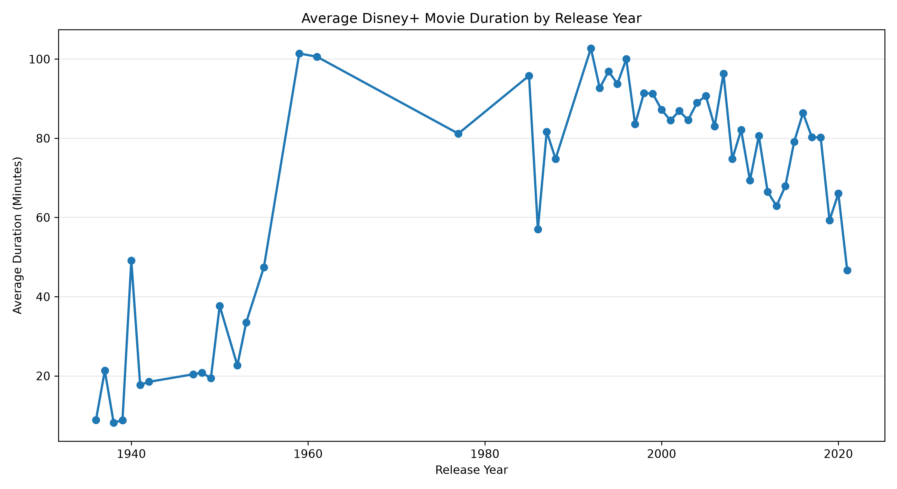
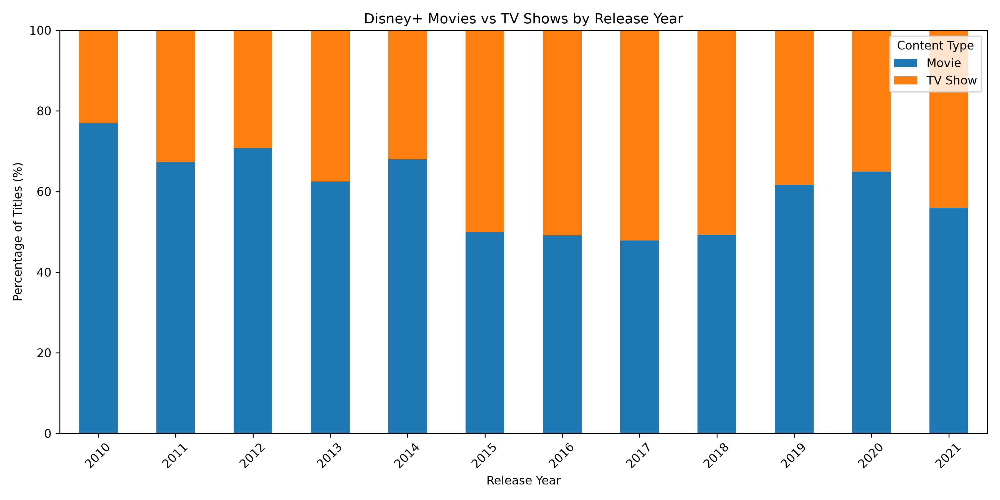

# Streaming Platform Content Analysis

**PostgreSQL | SQL | Python | Pandas | Matplotlib**

## Project Overview

This project analyzes and compares content catalogs from Disney+ and Amazon Prime Video using PostgreSQL and Python.

The analysis explores content distribution, movie durations, popular genres, and release-year trends. PostgreSQL is used to clean, combine, and analyze the datasets, while Python, Pandas, and Matplotlib are used to create visualizations and communicate findings.

## Dataset

The analysis includes 11,118 records across two streaming platforms.

| Platform | Records |
|---|---:|
| Disney+ | 1,450 |
| Amazon Prime Video | 9,668 |
| **Total** | **11,118** |

Both datasets contain information about movies and TV shows, including titles, release years, content ratings, durations, genres, and countries.

## Technologies Used

- **PostgreSQL:** Data storage, cleaning, and analysis
- **SQL:** Aggregations, joins-independent dataset integration, CTEs, subqueries, window functions, and string manipulation
- **Python:** Data processing and visualization
- **Pandas:** CSV processing and DataFrame manipulation
- **Matplotlib:** Creating charts and comparing trends
- **GitHub:** Project documentation and version control

## SQL Techniques Demonstrated

- Filtering and aggregating data using `WHERE`, `GROUP BY`, `HAVING`, `COUNT()`, and `AVG()`
- Using Common Table Expressions (CTEs) and subqueries
- Applying window functions such as `RANK()` and `PARTITION BY`
- Combining platform datasets using `UNION ALL`
- Cleaning and extracting text using `TRIM()`, `SPLIT_PART()`, and `CAST()`
- Calculating percentages to compare datasets of different sizes

## Key Findings

### 1. Content Distribution

Amazon Prime has a higher proportion of movies (80.82%) compared to Disney+ (72.55%), while Disney+ has a higher proportion of TV shows.

### 2. Average Movie Duration

Movies on Amazon Prime have an average duration of 91.3 minutes, compared to 71.9 minutes on Disney+, making Amazon Prime movies approximately **19.4 minutes longer on average**.

### 3. Release Year Distribution

Both platforms have their highest percentage of titles released in 2021 within the analyzed 2010–2021 period, indicating that recent releases make up a relatively larger share of their content in that timeframe.

## Data Visualizations

### Streaming Platform Comparisons

**1. Movies vs TV Shows by Platform**

**2. Average Movie Duration**

**3. Release Year Distribution**

### Disney+ Content Analysis

**4. Top 10 Genres**

**5. Movies vs TV Shows Distribution**

**6. Top Countries by Content**

**7. Average Movie Duration by Release Year**

**8. Movie vs TV Show Share by Release Year**

## How to Run

**1. Clone the repository**

Download or clone the repository to your computer.

**2. Install Python dependencies**

Run:

`pip install -r requirements.txt`

**3. Review the SQL analysis**

The `sql/` directory contains the original Disney+ analysis and the cross-platform comparison queries.

To rerun the SQL analysis, import the source datasets into PostgreSQL and execute the corresponding SQL scripts.

**4. Generate visualizations**

The `data/` directory contains exported SQL results used by the Python visualization scripts.

For example:

`python visualize_platform_comparison.py`

The generated visualizations are saved in the `charts/` directory.

## Data Sources

The datasets were obtained from Kaggle:

- [Disney+ Movies and TV Shows Dataset](https://www.kaggle.com/datasets/shivamb/disney-movies-and-tv-shows)
- [Amazon Prime Movies and TV Shows Dataset](https://www.kaggle.com/datasets/shivamb/amazon-prime-movies-and-tv-shows)

## Limitations

The datasets represent historical snapshots of streaming content catalogs and may not reflect current platform libraries.

Differences in dataset sizes, coverage, and collection periods may influence comparisons. Release-year analysis refers to when titles were originally released, not when they were added to a streaming platform.